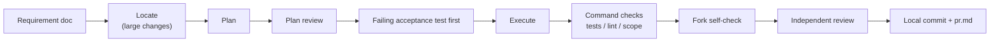

# Evidence-first Dev Workflow

English | [简体中文](README.zh-CN.md)

This repository provides one skill, `dev-flow`, that takes an AI coding agent from a one-line request to a PR-ready state: the changes are committed on a local feature branch and the PR description is written to a file; you push and open the PR yourself. You can also have it run just one stage: locate, plan, execute, review a plan or code, or triage someone else's review.

It targets the usual problems when agents write code: guessing before reading the code, changing files outside the requirement, and review loops that run for hours without converging. It hands these constraints to files and scripts so they depend less on the model's self-discipline:

- **Requirement doc**: your words are saved verbatim and sorted sentence by sentence into decisions, examples / reasons, and factual claims. Success criteria come only from decisions; factual claims are verified against the code. Any doubt the agent has about your words can only become a question for you, never a wider change.
- **Change map**: the plan stage writes down which files may change, and a script checks the actual changes against git; anything out of scope stops the flow and asks you.
- **Independent review**: the plan and the code each go to a separate reviewer agent (codex, claude or dsh). Every round is a new process that sees only the files in the run directory, and the review prompts are fixed files the coding agent can't rewrite.
- **Round limits**: plan review gets 1 round, plus 1 targeted re-review when a [core] finding was adopted; code review gets at most 2 rounds. Every finding is judged adopted, rejected or void, and a rejection must carry evidence.
- **Stops to ask you in only six cases**: an ambiguous requirement, a fix that needs files or behavior outside the scope, a deadlock with the reviewer, the same problem surviving two fixes, no reviewer available, or a premise in your words that contradicts the code.



## Requirements

- git and bash (the scripts have only been tested with macOS's bundled bash 3.2)
- At least one reviewer CLI: `codex`, `claude` or `dsh`, signed in and runnable from a terminal
- A coding agent that can read and write files and run commands, such as Claude Code or Codex

## Install

```bash
git clone https://github.com/mafirs/evidence-first.git
cd evidence-first
./install.sh en     # Chinese version: ./install.sh
```

`install.sh` symlinks `skills/<lang>/dev-flow` into `~/.claude/skills` (Claude Code) and `~/.agents/skills` (Codex). Existing entries with the same name are skipped, never overwritten; broken `ef-*` links left by earlier versions are removed. Run `git pull` in the repository to update. Start a new session after installing. To uninstall, delete the `dev-flow` links in those two directories.

## Usage

The skill triggers on its own. Hand over a code change and ask the agent to go through planning, review and testing itself, or just say "run dev-flow", and it runs the full flow.

To run a single stage, name dev-flow and the stage; it stops when that stage is done:

- "dev-flow locate …": read-only; produces the requirement doc and known facts with file:line.
- "dev-flow plan only": requirement doc, plan, change map and plan review; no branch, no code changes.
- "dev-flow execute this plan": takes the plan in the run directory or one you give it, writes a failing test first, then executes, checks, self-checks and commits to a feature branch.
- "dev-flow review this plan" / "dev-flow review this branch": one round of independent review with every finding judged; nothing is changed. When reviewing someone else's branch, the PR description and commit messages serve as the requirement source.
- "dev-flow self-check": one fork self-check round, report only.
- "dev-flow triage this review": checks each item of a review you paste against the code and judges it adopted, rejected or unverifiable; nothing is changed.
- "dev-flow continue <run dir or task short name>": works out where things stand from the files already in the run directory and picks up at the next step.

Hands-on testing in the UI is off by default; ask for it in the request when you want it, for example "test it in the browser".

## Reviewers

`review.sh` looks for a reviewer in the order of `DEV_FLOW_REVIEWERS`, default `codex claude dsh`, skipping any that aren't installed; when one fails, produces empty output or no valid verdict line, it moves on to the next.

```bash
export DEV_FLOW_REVIEWERS="dsh codex"      # change the order
export DEV_FLOW_DSH_PROFILE=headless       # dsh profile name, default headless
export DEV_FLOW_REVIEWER="your-cli --flag"  # use only this command, no fallback
```

The reviewer should preferably be a different model from the coding agent: when Claude Code writes the code, put `claude` last.

For one-off instructions to the reviewer (for example "focus on concurrency this time"), just tell the agent; it writes your words verbatim into `review-note.md` in the run directory, which is appended to every review message.

## Run directory

Each task gets a run directory outside the repository, `~/.vibe-runs/<repo name>/<date>-<task short name>/`, so nothing ends up in the PR. It holds the requirement doc `requirement.md`, the plan `plan.md`, the change map `scope.txt`, the check log `checks.log`, the review texts and the judgment record `closed.md`, and the PR description `pr.md`. When the context is compressed, the session is interrupted, or another agent takes over, everything is recovered from these files.

## Global rules

[AGENTS.en.md](AGENTS.en.md) ([中文](AGENTS.md)) holds the global rules behind this way of working, ready to put into the global configuration of Codex, Claude Code, Cursor and similar tools. The execution-layer rules dev-flow relies on are also copied into the skill's `references/execution-rules.md`, so the skill works on its own.

## Repository layout

```
skills/en/dev-flow/        English skill
  SKILL.md                 flow, entry points, stop conditions
  prompts/                 fixed prompts for plan review, code review and the fork self-check
  templates/requirement.md requirement doc template
  references/              execution-layer rules, task baseline (BASELINE) rules
  scripts/                 check_scope.sh, review.sh, run_check.sh
skills/zh-CN/dev-flow/     Chinese skill, same layout
tests/run.sh               tests the scripts in throwaway repos with fake reviewers
```

After changing the scripts, run `tests/run.sh`; both languages go through the same cases.

## License

[MIT](LICENSE)
