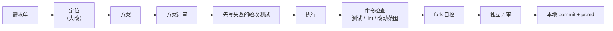

# Evidence-first Dev Workflow

[English](README.md) | 简体中文

这个仓库提供一个技能 `dev-flow`：让 AI coding agent 从一句话需求走到可以提 PR 的状态。改动 commit 在本地功能分支上，PR 描述写进文件，推送和创建 PR 由你自己做。也可以只让它做其中一段：定位、出方案、执行、评审方案或代码、处理别人的评审意见。

它要解决的是 agent 写代码时常见的几个问题：没读代码就猜、改需求之外的文件、评审来回好几个小时也收不住。做法是把这些约束交给文件和脚本，减少对模型自觉的依赖：

- **需求单**：你的原话逐字保存，逐句分成「决定」「比方 / 理由」「事实判断」三类。成功标准只来自「决定」；「事实判断」要读代码核实。agent 对你原话的疑问只能写成问题交给你，不能据此扩大改动。
- **改动地图**：方案阶段写下允许改动的文件，脚本对照 git 检查实际改动，超出范围就停下问你。
- **独立评审**：方案和代码分别交给另一个评审 agent（codex、claude 或 dsh）。每轮都是新进程，评审方只看运行目录里的文件，评审 Prompt 固定，写代码的 agent 不能改写。
- **轮数上限**：方案评审 1 轮，采纳了 [核心] 问题时加 1 轮定向复审；代码评审最多 2 轮。每条评审意见判定为采纳、驳回或作废，驳回必须附证据。
- **只在六种情况停下问你**：需求有歧义、要改范围外的文件或原有行为、和评审方僵持、同一个问题修了两次还在、没有可用的评审方、你原话的前提和代码不符。



## 需要什么

- git 和 bash（脚本只在 macOS 自带的 bash 3.2 上测过）
- 至少一个评审方命令行工具：`codex`、`claude` 或 `dsh`，已登录、能在终端里运行
- 一个能读写文件、运行命令的 coding agent，例如 Claude Code 或 Codex

## 安装

```bash
git clone https://github.com/mafirs/evidence-first.git
cd evidence-first
./install.sh        # 英文版：./install.sh en
```

`install.sh` 把 `skills/<语言>/dev-flow` 软链接到 `~/.claude/skills`（Claude Code）和 `~/.agents/skills`（Codex）。已有同名条目时跳过、不覆盖；旧版本留下的 `ef-*` 失效链接会被删除。更新时在仓库里 `git pull`。装好后新开一个会话。卸载就删掉这两个目录里的 `dev-flow` 链接。

## 怎么用

技能会自动触发。交代一个改代码的需求并要求它自己走完方案、评审、测试，或者直接说"按 dev-flow 走"，就走完整流程。

只做一段时点名 dev-flow 和那一段，做完这一段就停：

- "dev-flow 定位一下 …"：只读，产出需求单和带文件:行号的已知事实。
- "dev-flow 只出方案"：需求单、方案、改动地图和方案评审，不切分支，不改代码。
- "dev-flow 执行这个方案"：拿运行目录里的方案或你给的方案，先写失败的测试，再执行、检查、自检，commit 到功能分支。
- "dev-flow 评审这个方案" / "dev-flow 评审这个分支"：跑一轮独立评审，逐条判定，不改东西。评审别人的分支时，PR 描述和 commit message 会被当成需求来源。
- "dev-flow 自检"：跑一轮 fork 自检，只报告。
- "dev-flow 处理这份评审意见"：把你贴来的评审逐条打开代码核对，判定采纳、驳回或无法核实，不改东西。
- "dev-flow 接着走 <运行目录或任务简称>"：按运行目录里已有的文件判断做到哪一步，从下一步继续。

页面实测默认不做；需要时在需求里写明，比如"用浏览器实测一下"。

## 评审方

`review.sh` 按 `DEV_FLOW_REVIEWERS` 的顺序找评审方，默认 `codex claude dsh`，跳过没装的；某个失败、输出为空或没有有效结论行，就换下一个。

```bash
export DEV_FLOW_REVIEWERS="dsh codex"      # 改顺序
export DEV_FLOW_DSH_PROFILE=headless       # dsh 用的配置名，默认 headless
export DEV_FLOW_REVIEWER="your-cli --flag"  # 只用这一个命令，失败不换
```

评审方最好和写代码的 agent 不是同一个模型：用 Claude Code 写代码时，把 `claude` 排在后面。

对评审方的临时要求（比如"这次重点看并发"）直接告诉 agent，它会原样写进运行目录的 `review-note.md`，附在每轮评审消息里。

## 运行目录

每个任务一个运行目录，放在仓库外的 `~/.vibe-runs/<仓库名>/<日期>-<任务简称>/`，不会进 PR。里面有需求单 `requirement.md`、方案 `plan.md`、改动地图 `scope.txt`、检查日志 `checks.log`、评审原文和判定记录 `closed.md`、PR 描述 `pr.md`。上下文被压缩、会话中断或换一个 agent 接手时，都从这些文件恢复。

## 全局规则

[AGENTS.md](AGENTS.md)（[English](AGENTS.en.md)）是这套工作方式背后的全局规则，可以放进 Codex、Claude Code、Cursor 等工具的全局配置。dev-flow 用到的执行层规则在技能目录的 `references/execution-rules.md` 里另有一份，只装技能也能用。

## 仓库结构

```
skills/zh-CN/dev-flow/     中文版技能
  SKILL.md                 流程、入口、停下条件
  prompts/                 方案评审、代码评审、fork 自检的固定 Prompt
  templates/requirement.md 需求单模板
  references/              执行层规则、任务基线（BASELINE）维护规则
  scripts/                 check_scope.sh、review.sh、run_check.sh
skills/en/dev-flow/        英文版，结构相同
tests/run.sh               用假评审方在临时仓库里测脚本
```

改脚本后运行 `tests/run.sh`，两种语言跑同一组用例。

## 许可

[MIT](LICENSE)
